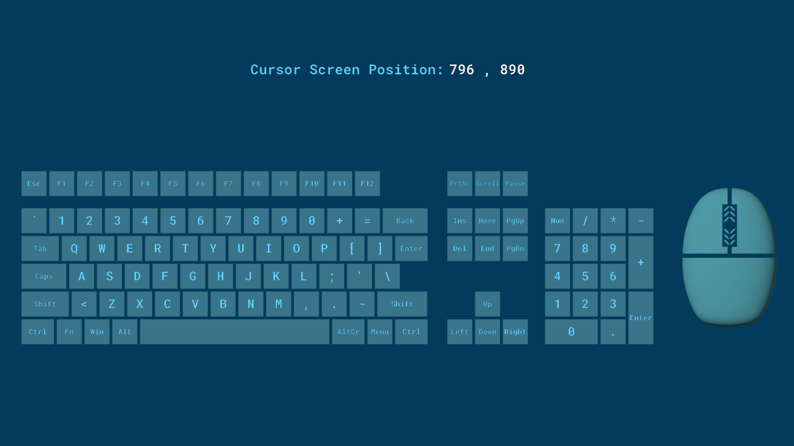

  

# InputKeyboardMouse

This example demonstrates keyboard and mouse input in Rendering Engine, including interactive 2D objects that respond to mouse clicks.

The application displays a virtual PC keyboard and mouse. Physical input is visualized by changing the colors of the corresponding keys and mouse buttons. The virtual keyboard also responds to mouse clicks.

## Features

- **Keyboard input:** Visualizes key press and release events on a virtual PC keyboard.
- **Mouse buttons:** Highlights the left and right mouse buttons when pressed.
- **Cursor position:** Displays the current mouse coordinates.
- **Mouse wheel:** Highlights scrolling direction.
- **Interactive 2D objects:** Virtual keyboard keys respond to mouse clicks using physical geometry and interaction callbacks.
- **Window resizing:** The active 2D camera follows the actual window dimensions to maintain correct mouse hit-testing.

## Try It

Launch the application and try pressing keys on your physical keyboard, clicking the virtual keys, moving the mouse, and scrolling the wheel.

## Implementation

The example uses `InputController` to query keyboard and mouse state during scene updates.

The virtual keyboard consists of individual `PCKeyboardKeyActor` instances arranged by `PCKeyboardActor`. Each key contains a rectangle, text label, and physical geometry for mouse interaction.

`InteractionRouter2D` handles mouse interactions with registered 2D geometry.

### Source Files

| File | Description |
|---|---|
| [start_level.cpp](Source/start_level.cpp) | Creates and positions the keyboard and mouse actors |
| [pckeyboard_actor.cpp](Source/pckeyboard_actor.cpp) | Defines the keyboard layout and creates individual keys |
| [pc_keyboard_key_actor.cpp](Source/pc_keyboard_key_actor.cpp) | Handles key states, appearance, and mouse interaction |
| [pcmouse_actor.cpp](Source/pcmouse_actor.cpp) | Visualizes mouse buttons, cursor position, and scrolling |

## Documentation

See the [Input Controller Guide](../../Doc/input_controller_guide.md) for API usage, code examples, input event processing, and interactive 2D objects.